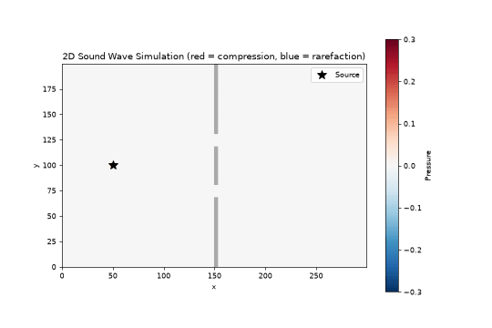

# SoundViewer

An interactive 2D sound wave simulator in Python. A sound source sends waves across the screen, they hit a wall with two slits, and you can watch them diffract and interfere with each other.



## What it does

- Simulates the 2D wave equation with a finite-difference method (NumPy)
- Shows pressure as a live heatmap: red is compression, blue is rarefaction
- Includes a wall with two slits, so you can see double-slit interference
- Uses absorbing edges so waves fade out instead of bouncing back
- Records a 10-second GIF of whatever you're looking at

## Install

```bash
pip install numpy matplotlib pillow
```

The program needs a window backend to display. If it says none was found, install one:

```bash
pip install PyQt6
```

On Linux you can use Tk instead:

```bash
sudo apt install python3-tk
```

## Run

```bash
python Main.py
```

## Controls

| Control | What it does |
|---|---|
| Click and drag on the plot | Move the sound source |
| Frequency slider | Change the source frequency |
| Pause / Play | Freeze or resume the simulation |
| Clear waves | Remove all waves from the screen |
| Record 10 s GIF | Save a GIF as `sound_waves_<date>_<time>.gif` in the current folder |

## Things to try

- Move the source close to the wall, then far from it, and watch how the pattern changes
- Raise the frequency to shorten the wavelength and see the interference fringes get tighter
- Drag the source behind the wall's solid part and watch the waves bend through the slits

## Settings

Grid size, wall position, slit size, GIF length and frame rate are constants at the top of `Main.py`. Change them and run again.
